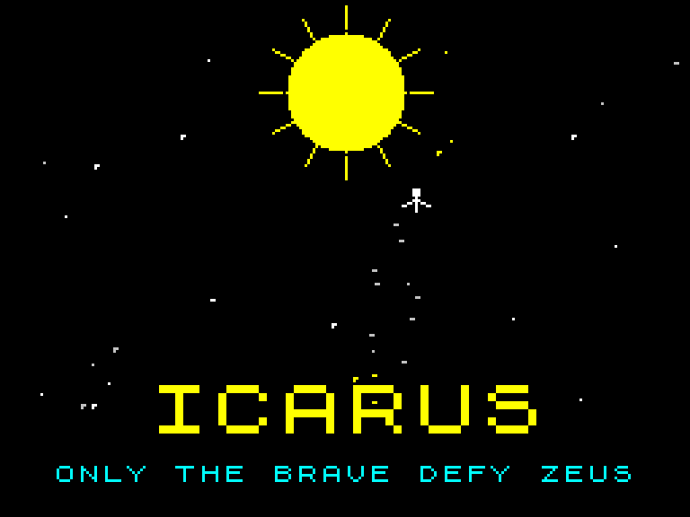

# ICARUS — ZX Spectrum 48K

> **Only the brave defy Zeus.**

ICARUS is an original score-chasing arcade game written in Z80 assembly for the ZX Spectrum 48K. Collect stars, avoid Zeus's attacks, build combos, face Zeus, Cronos and Medusa, and earn a place in the Top 5.

[](https://mmmpt.github.io/icarus-zx-spectrum/)
[](https://github.com/MmmPT/icarus-zx-spectrum/releases/download/downloads-2026-10-31/Icarus_ZX_Spectrum_v1.0.zip)



## Features

- Fast, score-driven arcade gameplay
- Seven increasingly demanding levels
- Stars, gold stars and extra-life hearts
- Wide-paddle, shield and UFO power-ups
- Boss encounters with Zeus, Cronos and Medusa
- Combo system and Top 5 high-score table
- Keyboard and Kempston joystick support
- Runs on ZX Spectrum 48K; AY music on compatible 128K models

## Controls

| Control | Action |
|---|---|
| `O` / `P` | Move |
| Kempston joystick | Move |
| `SPACE` | Pause |
| `M` | Toggle music |
| Any key | Start or continue when prompted |

## Download and play

Download [`Icarus_ZX_Spectrum_v1.0.zip`](https://github.com/MmmPT/icarus-zx-spectrum/releases/download/downloads-2026-10-31/Icarus_ZX_Spectrum_v1.0.zip), extract it and load `Icarus.tap` in a real ZX Spectrum or a compatible emulator.

On a real machine:

```text
LOAD ""
```

Then start the tape or the device playing the TAP image. Many emulators can open the TAP file directly.

## Build from source

### Requirements

- [Pasmo](https://pasmo.speccy.org/) Z80 assembler
- Python 3
- GNU Make, optional

### Complete TAP with loading screen

```bash
make
```

The result is written to `build/Icarus.tap`.

Equivalent manual commands:

```bash
mkdir -p build
cd src
pasmo icarus.asm ../build/icarus.bin ../build/icarus.sym
cd ..
python3 tools/build_tap.py \
  --loader assets/basic_loader.bin \
  --screen assets/loadscr.scr \
  --code build/icarus.bin \
  --output build/Icarus.tap
```

The released v1.0 TAP has this SHA-256 checksum:

```text
f3247a40daf56174e9046a7ef8b503fd4a0c2ff7e6d311e9d12168f9109954c3
```

## Repository structure

```text
src/          Z80 assembly source and tables
assets/       BASIC loader and loading screen data
tools/        TAP-building utility
release/      Ready-to-play v1.0 files
screenshots/  Genuine emulator captures
docs/         Static GitHub Pages website
```

The ZX Spectrum ROM and temporary emulator memory dumps are deliberately **not included** in this public repository.

## Credits and AI disclosure

**Game design and programming:** MMM  
**Repository:** MmmPT

Claude AI was used as a programming assistant during development. Design choices, integration, testing and the final release were carried out by the author.

## Licensing

Source code in `src/` and `tools/` is released under the MIT License. The game title, loading artwork, screenshots, compiled binaries and other non-code assets remain © 2026 MMM and are not covered by the MIT License. See [`LICENSE`](LICENSE) and [`ASSET-LICENSE.md`](ASSET-LICENSE.md).

## Download statistics

[Download statistics](https://github.com/MmmPT/icarus-zx-spectrum/releases/tag/downloads-2026-10-31) are recorded by GitHub for the release assets from **31 October 2026**. The game page shows the total across the downloadable formats. This counts file downloads, not unique players; earlier direct downloads, repository clones and browser play are not included.

Release assets are retained to preserve their counters. For a future game update, publish a new release or use new asset filenames rather than replacing an existing asset, then update the download links.
